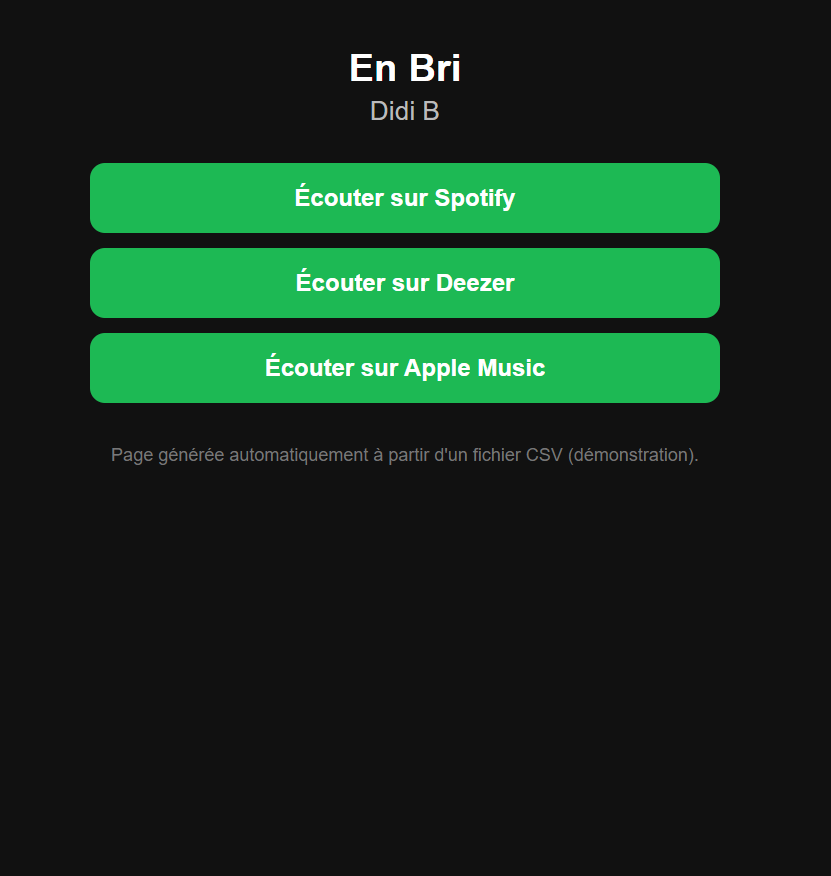

# Générateur de fanlinks (démonstration)

Un script Python qui lit un fichier CSV et crée automatiquement une page de fanlink pour chaque titre : une page unique avec les boutons vers Spotify, Deezer, Apple Music et une boutique.

**Démonstration en ligne :** [https://reine929.github.io/generateur-fanlinks/]



## À quoi ça sert
Quand un artiste sort un titre, il faut une page qui rassemble les liens vers les plateformes. Ici, on part d'un fichier CSV (une ligne par titre) et le script génère toutes les pages d'un coup.

Si un titre n'a pas encore de liens (artiste nouveau ou sortie à venir), la page affiche « Bientôt disponible ». Dès qu'on ajoute les liens dans le CSV et qu'on relance le script, les boutons apparaissent.

## Comment ça marche
1. `tracks.csv` : les titres, avec les colonnes artiste, titre, et un lien par plateforme (vide si pas encore disponible).
2. `template.html` : le modèle de la page, avec des trous (`$title`, `$artist`, `$buttons`).
3. `generer_fanlinks.py` : lit le CSV, construit les boutons pour les liens remplis, remplit le modèle et écrit une page HTML par titre dans le dossier `docs/`, plus une page d'accueil `index.html`.

## Lancer le script
```
python generer_fanlinks.py
```
Les pages sont créées dans le dossier `docs/`. Ouvrir `docs/index.html` dans un navigateur.

## À noter
- C'est une démonstration avec cinq titres tirés d'une playlist Spotify de rap ivoirien (projet d'analyse des tendances musicales). Ce ne sont pas des données d'un distributeur. La ligne « Artiste Exemple » est fictive.
- Les liens Spotify viennent de l'API Spotify (identifiants des morceaux). Les liens Deezer et Apple Music ont été trouvés par recherche puis vérifiés.
- Limites : pas de lien de boutique dans la démo, un style simple, et le script ne génère que des pages statiques.

## Technologies
Python (modules `csv`, `pathlib`, `string`), HTML et CSS.

Auteure : Fanta Reine Ouattara
